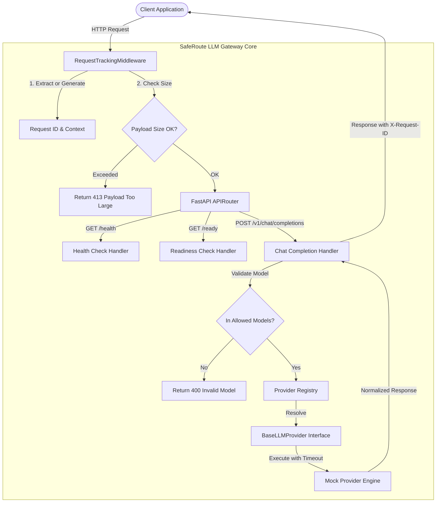

# SafeRoute LLM Gateway

SafeRoute is a lightweight, reliable, and observable LLM Gateway built with Python and FastAPI. It sits between client applications and AI model providers, standardizing chat completions, enforcing safety guardrails, and providing unified error handling, structured logging, and observability.

---

## Table of Contents
- [What is an LLM Gateway?](#what-is-an-llm-gateway)
- [The Problem SafeRoute Solves](#the-problem-saferoute-solves)
- [Architecture Diagram](#architecture-diagram)
- [Phase 1: What is Implemented vs. What is NOT Implemented](#phase-1-what-is-implemented-vs-what-is-not-implemented)
- [Project Structure](#project-structure)
- [Setup and Installation](#setup-and-installation)
- [Environment Configuration](#environment-configuration)
- [Running the Gateway](#running-the-gateway)
- [API Reference & Examples](#api-reference--examples)
  - [Liveness Check (`GET /health`)](#liveness-check-get-health)
  - [Readiness Check (`GET /ready`)](#readiness-check-get-ready)
  - [Chat Completion (`POST /v1/chat/completions`)](#chat-completion-post-v1chatcompletions)
  - [Standardized Error Responses](#standardized-error-responses)
- [Running Tests](#running-tests)
- [Known Limitations & Next Planned Phase](#known-limitations--next-planned-phase)

---

## What is an LLM Gateway?

An **LLM Gateway** is a reverse proxy and middleware service tailored for Large Language Models. Instead of applications connecting directly to varied, disparate third-party model providers (such as OpenAI, Anthropic, Google, or local Ollama instances), applications send standard requests to the gateway.

The gateway validates requests, enforces policies (rate limits, prompt safety, allowed models), orchestrates upstream calls, and normalizes responses and errors.

```
+--------------------+         +------------------------+         +----------------------+
| Client Application | ------> | SafeRoute LLM Gateway  | ------> | Upstream LLM Backend |
| (Your App / Agent) | <------ |  (Validation & Proxy)  | <------ |  (Mock, Ollama, etc) |
+--------------------+         +------------------------+         +----------------------+
```

---

## The Problem SafeRoute Solves

When teams build AI-powered features directly against upstream LLM APIs, they frequently encounter major challenges:
1. **API Vendor Lock-in**: Different providers use divergent request/response shapes and error semantics.
2. **Lack of Centralized Governance**: It is hard to enforce token budgets, allowed models, payload size limits, or timeouts across multiple apps.
3. **Inconsistent Error Handling**: Upstream outages or timeouts often cause uncaught crashes or leak internal API tokens and stack traces to clients.
4. **Poor Observability**: Debugging distributed systems without request correlation IDs or structured logging makes root-cause analysis difficult.

SafeRoute solves this by providing a unified, OpenAI-compatible entrypoint with built-in safety controls, request tracking, and standardized error handling.

---

## Architecture Diagram



---

## Phase 1: What is Implemented vs. What is NOT Implemented

### Implemented in Phase 1 (Foundation):
- **Endpoints**: `GET /health`, `GET /ready`, and `POST /v1/chat/completions`.
- **API Contract**: OpenAI-compatible non-streaming chat completions.
- **Strict Validation**: Pydantic v2 schemas forbidding extra/unsupported fields, enforcing allowed roles (`system`, `user`, `assistant`), plain-text constraints, and temperature bounds.
- **Provider Interface**: Abstract `BaseLLMProvider` decoupling route handlers from provider-specific logic.
- **In-Memory Mock Provider**: Deterministic, cost-free mock provider with test usage estimation and simulation modes (`mock-timeout`, `mock-error`, `mock-malformed`). Pure in-memory execution with zero external network calls.
- **Request ID Tracking**: Request IDs generated via UUID or validated from incoming `X-Request-ID` headers; tracked via `contextvars` and included in response headers.
- **Structured JSON Logging**: Safe JSON logging that avoids logging prompt content, sensitive keys, or secrets.
- **Standardized Error Responses**: Uniform error JSON format with specific HTTP status codes (400, 413, 422, 502, 504, 500) and no stack trace leaks.
- **Automated Test Suite**: 40 unit and integration tests covering all error conditions and positive flows.

### NOT Implemented in Phase 1 (Scheduled for Future Phases):
- **Real Cloud Model Providers**: No live calls to OpenAI, Claude, Gemini, or Ollama yet.
- **Persistent Storage**: No SQLite or PostgreSQL databases.
- **Caching & Rate Limiting**: No Redis, exact response caching, or semantic caching.
- **Vector Search & Embeddings**: No vector databases or embedding models.
- **PII & Prompt Injection Checks**: No content scanning or security classifiers.
- **Streaming (SSE)**: `stream=true` is explicitly rejected.
- **Authentication**: Client API-key authentication will be added in a subsequent phase.
- **Containers / K8s**: Docker and container orchestration.

---

## Project Structure

```text
d:/SafeRoute LLM Gateway/
├── .env.example              # Example environment configuration
├── .gitignore                # Git ignore patterns
├── pyproject.toml            # Project packaging and dependencies
├── README.md                 # Complete documentation
├── app/
│   ├── __init__.py           # Application package
│   ├── main.py               # FastAPI entry point & tracking middleware
│   ├── config.py             # Settings using pydantic-settings
│   ├── api/
│   │   ├── __init__.py
│   │   ├── routes.py         # /health, /ready, /v1/chat/completions
│   │   └── schemas.py        # Strict Pydantic v2 schemas
│   ├── core/
│   │   ├── __init__.py
│   │   ├── errors.py         # Standardized error normalization & handlers
│   │   ├── logging.py        # Safe structured JSON logger
│   │   └── request_context.py# Request ID contextvars manager
│   └── providers/
│       ├── __init__.py       # Provider registry & lookup
│       ├── base.py           # Abstract BaseLLMProvider interface
│       └── mock.py           # Deterministic in-memory mock provider
└── tests/
    ├── __init__.py
    ├── conftest.py           # Pytest fixtures and settings overrides
    ├── unit/
    │   ├── __init__.py
    │   ├── test_config.py    # Config unit tests
    │   ├── test_schemas.py   # Pydantic validation unit tests
    │   └── test_mock_provider.py # Mock provider & offline isolation tests
    └── integration/
        ├── __init__.py
        ├── test_health.py    # /health and /ready integration tests
        ├── test_chat_completions.py # Chat completion integration tests
        └── test_errors.py    # Timeouts, 502, 504, 400, 422, 500 error tests
```

---

## Setup and Installation

### Prerequisites
- Python **3.10+** (tested on Python 3.13)
- `pip`

### 1. Clone or Open the Workspace
```bash
cd "d:/SafeRoute LLM Gateway"
```

### 2. (Optional) Create a Virtual Environment
```bash
python -m venv .venv
# On Windows:
.venv\Scripts\activate
# On Linux / macOS:
source .venv/bin/activate
```

### 3. Install Dependencies
```bash
pip install fastapi uvicorn pydantic pydantic-settings httpx pytest
```

---

## Environment Configuration

Copy the example file to `.env`:

```bash
cp .env.example .env
```

Available configuration options:

| Variable | Default Value | Description |
| :--- | :--- | :--- |
| `APP_ENV` | `development` | Deployment environment (`development`, `staging`, `production`, `test`) |
| `ALLOWED_MODELS` | `mock-model,mock-timeout,mock-error,mock-malformed` | Comma-separated list of permitted model IDs |
| `DEFAULT_MODEL` | `mock-model` | Default model identifier |
| `MAX_REQUEST_SIZE_BYTES` | `1048576` (1MB) | Maximum HTTP payload size accepted |
| `MAX_MESSAGES_PER_REQUEST` | `50` | Maximum message count per chat request |
| `MAX_COMPLETION_TOKENS_LIMIT` | `4096` | Maximum allowed `max_completion_tokens` |
| `PROVIDER_TIMEOUT_SECONDS` | `5.0` | Upstream provider timeout before returning 504 |
| `LOG_LEVEL` | `INFO` | Logger verbosity level |

---

## Running the Gateway

Start the application with Uvicorn:

```bash
uvicorn app.main:app --host 127.0.0.1 --port 8000 --reload
```

The server will be available at `http://127.0.0.1:8000`. Interactive OpenAPI documentation is available at `http://127.0.0.1:8000/docs`.

---

## API Reference & Examples

### Liveness Check (`GET /health`)

Returns basic service liveness.

**Request:**
```bash
curl -X GET http://127.0.0.1:8000/health
```

**Response (HTTP 200 OK):**
```json
{
  "status": "ok",
  "app": "SafeRoute LLM Gateway",
  "environment": "development"
}
```

---

### Readiness Check (`GET /ready`)

Verifies that registered providers and dependencies are accessible.

**Request:**
```bash
curl -X GET http://127.0.0.1:8000/ready
```

**Response (HTTP 200 OK):**
```json
{
  "status": "ready",
  "providers": {
    "mock": "available"
  }
}
```

---

### Chat Completion (`POST /v1/chat/completions`)

Submits messages for non-streaming chat completion.

**Request:**
```bash
curl -X POST http://127.0.0.1:8000/v1/chat/completions \
  -H "Content-Type: application/json" \
  -d '{
    "model": "mock-model",
    "messages": [
      {
        "role": "system",
        "content": "You are a helpful assistant."
      },
      {
        "role": "user",
        "content": "Explain what an LLM gateway does."
      }
    ],
    "temperature": 0.2,
    "max_completion_tokens": 200,
    "stream": false
  }'
```

**Response (HTTP 200 OK):**
```json
{
  "id": "chatcmpl-mock-3b41f7f9d8e3",
  "object": "chat.completion",
  "created": 1792865952,
  "model": "mock-model",
  "choices": [
    {
      "index": 0,
      "message": {
        "role": "assistant",
        "content": "This is a deterministic response from the SafeRoute mock provider."
      },
      "finish_reason": "stop"
    }
  ],
  "usage": {
    "prompt_tokens": 15,
    "completion_tokens": 16,
    "total_tokens": 31,
    "is_mock_estimate": true
  }
}
```

*Response Header:* `X-Request-ID: req_5158b20427f9416986587767cadb11d9`

---

### Standardized Error Responses

All gateway errors follow a normalized structure:

```json
{
  "error": {
    "type": "error_category",
    "code": "specific_error_code",
    "message": "Human readable explanation",
    "request_id": "req_uuid"
  }
}
```

#### Example: Unsupported Field or Stream Requested (HTTP 400)
```json
{
  "error": {
    "type": "invalid_request_error",
    "code": "unsupported_parameter",
    "message": "Streaming is not supported in Phase 1.",
    "request_id": "req_c5a37aa113cb40b5a900898556955b08"
  }
}
```

#### Example: Model Not in Allowlist (HTTP 400)
```json
{
  "error": {
    "type": "invalid_request_error",
    "code": "invalid_model",
    "message": "The model 'unapproved-gpt-4' is not permitted or supported. Allowed models: mock-model, mock-timeout, mock-error, mock-malformed",
    "request_id": "req_993f885e33d0473cb22bc8c5bc170d49"
  }
}
```

#### Example: Provider Timeout (HTTP 504)
```json
{
  "error": {
    "type": "gateway_timeout_error",
    "code": "gateway_timeout",
    "message": "Upstream provider timed out after 5.0 seconds.",
    "request_id": "req_424a935e3675420bb7eb611b2cc04a5d"
  }
}
```

#### Example: Schema Validation Failure (HTTP 422)
```json
{
  "error": {
    "type": "invalid_request_error",
    "code": "validation_error",
    "message": "body -> messages: List should have at least 1 item after validation, not 0",
    "request_id": "req_83f6aa41712a449887b4ee732e98fa63"
  }
}
```

---

## Running Tests

Execute the full automated test suite with `pytest`:

```bash
pytest -v
```

Expected output:
```text
============================= test session starts =============================
platform win32 -- Python 3.13.5, pytest-8.3.4
collected 40 items

tests/integration/test_chat_completions.py::test_valid_chat_request_returns_documented_response PASSED
tests/integration/test_chat_completions.py::test_custom_request_id_preserved PASSED
tests/integration/test_chat_completions.py::test_invalid_custom_request_id_replaced_with_safe_id PASSED
tests/integration/test_errors.py::test_empty_messages_rejected PASSED
tests/integration/test_errors.py::test_whitespace_message_content_rejected PASSED
tests/integration/test_errors.py::test_unsupported_fields_rejected PASSED
tests/integration/test_errors.py::test_unsupported_role_rejected PASSED
tests/integration/test_errors.py::test_non_text_content_rejected PASSED
tests/integration/test_errors.py::test_invalid_model_rejected PASSED
tests/integration/test_errors.py::test_invalid_temperature_rejected PASSED
tests/integration/test_errors.py::test_invalid_token_limits_rejected PASSED
tests/integration/test_errors.py::test_token_limit_exceeding_system_max_rejected PASSED
tests/integration/test_errors.py::test_streaming_requests_rejected PASSED
tests/integration/test_errors.py::test_request_id_present_in_error_responses PASSED
tests/integration/test_errors.py::test_mock_provider_timeout_returns_504 PASSED
tests/integration/test_errors.py::test_mock_provider_malformed_returns_502 PASSED
tests/integration/test_errors.py::test_mock_provider_outage_returns_502 PASSED
tests/integration/test_errors.py::test_internal_exception_does_not_leak_stack_traces_or_secrets PASSED
tests/integration/test_errors.py::test_message_limit_exceeded_rejected PASSED
tests/integration/test_errors.py::test_payload_too_large_rejected PASSED
tests/integration/test_health.py::test_health_endpoint_success PASSED
tests/integration/test_health.py::test_ready_endpoint_success PASSED
tests/integration/test_health.py::test_ready_endpoint_failure PASSED
tests/unit/test_config.py::test_default_settings PASSED
tests/unit/test_config.py::test_allowed_models_parsing_from_string PASSED
tests/unit/test_config.py::test_allowed_models_from_list PASSED
tests/unit/test_mock_provider.py::test_mock_provider_deterministic_response PASSED
tests/unit/test_mock_provider.py::test_mock_provider_error_simulation PASSED
tests/unit/test_mock_provider.py::test_mock_provider_malformed_simulation PASSED
tests/unit/test_mock_provider.py::test_mock_provider_makes_no_network_calls PASSED
tests/unit/test_mock_provider.py::test_mock_provider_health_check PASSED
tests/unit/test_schemas.py::test_valid_chat_message PASSED
tests/unit/test_schemas.py::test_chat_message_rejects_empty_content PASSED
tests/unit/test_schemas.py::test_chat_message_rejects_unsupported_role PASSED
tests/unit/test_schemas.py::test_chat_message_forbids_extra_fields PASSED
tests/unit/test_schemas.py::test_valid_chat_completion_request PASSED
tests/unit/test_schemas.py::test_request_rejects_streaming PASSED
tests/unit/test_schemas.py::test_request_forbids_extra_fields PASSED
tests/unit/test_schemas.py::test_request_temperature_bounds PASSED
tests/unit/test_schemas.py::test_request_max_tokens_positive PASSED

============================= 40 passed in 0.57s ==============================
```

---

## Known Limitations & Next Planned Phase

### Known Limitations
- The gateway only interfaces with an in-memory mock provider.
- Streaming responses (`stream: true`) are intentionally rejected until SSE streaming support is added.
- Authentication (API keys) is not yet validated.
- Requests and token metrics are logged to stdout but not persisted to a database.

### Next Planned Phase (Phase 2 Preview)
- Integration of a real local provider adapter (e.g. Ollama for open-source models).
- Client API-key authentication middleware.
- Request persistence and usage tracking (SQLite).
- Latency and estimated cost calculation.
