# SafeRoute Hybrid RAG & Retrieval Architecture

## 1. Executive Summary & Clarification

In earlier documentation drafts, Phase 10 was erroneously described as "Hybrid RAG + Reranking" despite the underlying codebase at release `v1.0.0` implementing **Production Readiness & Operational Hardening**. Furthermore, semantic caching was occasionally conflated with RAG.

To maintain engineering integrity, this document establishes:
1. **The Fundamental Distinction**: Semantic Caching versus Retrieval-Augmented Generation (RAG).
2. **The Decoupled Hybrid RAG Extension**: An optional, zero-overhead extension located in `app/rag/` implementing the complete 12-stage RAG lifecycle.
3. **Formal Retrieval Evaluation**: Quantitative benchmark results (Recall@k, MRR, nDCG@k, and latency percentiles).

---

## 2. Semantic Caching vs. Hybrid RAG

| Architectural Dimension | Semantic Caching (`app/cache/`) | Hybrid RAG (`app/rag/`) |
| :--- | :--- | :--- |
| **Primary Goal** | Skip upstream LLM inference for semantically identical requests. | Augment LLM prompts with authoritative external domain knowledge. |
| **Data Ingested** | Previous user prompts and completed model responses. | External corpora, technical manuals, documentation, or FAQs. |
| **Index Structure** | Inverted vector index in Redis or memory keyed by `client_id`. | Dual-tier index: Inverted Okapi BM25 sparse index + dense vector index. |
| **Retrieval Strategy** | Dense cosine similarity above threshold (e.g., 0.85). | Sparse BM25 + dense vector cosine similarity fused via Reciprocal Rank Fusion (RRF). |
| **Reranking** | Rejection heuristics (e.g., numeric entity mismatch detection). | Lexical token overlap + RRF score combination. |
| **Output** | Verbatim cached response from previous completion. | Synthesized answer generated by model grounded in retrieved passages with citations. |
| **Failure Mode** | Cache miss triggers standard upstream inference. | Retrieval failure yields grounded refusal ("information not available"). |

---

## 3. The 12-Stage Hybrid RAG Architecture

The `app/rag/` subsystem implements an end-to-end, reproducible retrieval pipeline:

```mermaid
flowchart TD
    subgraph Ingestion ["Ingestion & Indexing Lifecycle"]
        A[External Documents] --> B[Text Cleaner]
        B --> C[Sliding-Window Chunker]
        C --> D1[Sparse BM25 Index]
        C --> D2[Dense Vector Embeddings]
    end

    subgraph QueryExecution ["Query & Retrieval Lifecycle"]
        Q[User Query] --> E1[BM25 Keyword Search]
        Q --> E2[Dense Cosine Similarity]
        E1 --> F[Reciprocal Rank Fusion RRF]
        E2 --> F
        F --> G[Lexical Reranker]
        G --> H[Top-K Candidates]
        H --> I[Context Assembler & Citation Formatter]
        I --> J[Prompt with Grounded Context]
        J --> K[LLM / MockProvider Generation]
        K --> L[Structured RAGResponse + Citations]
    end
```

### Stage Details:
1. **Document Ingestion (`RAGDocument`)**: Ingests structured documents with `doc_id`, `title`, `content`, and arbitrary metadata.
2. **Text Cleaning (`TextChunker.clean_text`)**: Normalizes CRLF/LF line endings, collapses excessive whitespace, and preserves clean paragraph boundaries.
3. **Sliding-Window Chunking (`TextChunker.chunk_document`)**: Splits long documents into configurable passages (default 400 chars, 80 char overlap) breaking at natural sentence boundaries (`.`, `?`, `!`, `\n\n`).
4. **Embedding Generation (`BaseEmbeddingProvider`)**: Asynchronous or synchronous batch embedding generation using `DeterministicMockEmbeddingProvider` (for test/offline) or `LocalSentenceTransformerEmbeddingProvider` (`all-MiniLM-L6-v2`).
5. **Dense Vector Retrieval (`HybridRetriever.retrieve_dense`)**: Computes cosine similarities across corpus vectors and extracts candidate chunks.
6. **Sparse Keyword Retrieval (`BM25Index.search`)**: Computes Robertson-Sparck-Jones Okapi BM25 scores with term frequency and inverse document frequency ($k_1=1.5, b=0.75$).
7. **Hybrid Rank Fusion (`HybridRetriever.fuse_and_rerank`)**: Merges sparse and dense ranked candidate lists using Reciprocal Rank Fusion:
   $$\text{RRF Score} = \frac{w_{\text{vec}}}{k + \text{rank}_{\text{vec}}} + \frac{w_{\text{bm25}}}{k + \text{rank}_{\text{bm25}}}$$
   where $k=60, w_{\text{vec}}=0.5, w_{\text{bm25}}=0.5$.
8. **Candidate Reranking**: Evaluates query-passage token overlap ratio and blends 70% RRF score with 30% lexical overlap boost to prioritize exact term matches.
9. **Context Assembly (`RAGPipeline.assemble_context`)**: Formats retrieved passages into numbered context blocks (`[Source 1]`, `[Source 2]`).
10. **Prompt Formulation**: Enforces a strict grounding instruction instructing the model to rely solely on provided context and explicitly cite sources.
11. **Citation Attribution (`Citation`)**: Attaches structured citations with source index, document ID, chunk ID, title, and excerpt snippet to the response envelope.
12. **Automated Evaluation (`RAGEvaluator`)**: Measures quantitative retrieval benchmarks against labeled ground-truth evaluation suites.

---

## 4. Benchmark Evaluation Results

The evaluation suite (`datasets/rag/evaluation_queries.json`) tested against the sample knowledge base (`datasets/rag/sample_knowledge_base.json`) yielded the following verified measurements:

| Metric | Measured Value | Target Standard | Status |
| :--- | :--- | :--- | :--- |
| **Total Benchmark Queries** | 5 | $\ge 5$ | Verified |
| **Mean Recall@3** | **1.0000 (100%)** | $\ge 0.80$ | Exceeded |
| **Mean Reciprocal Rank (MRR)** | **1.0000** | $\ge 0.75$ | Exceeded |
| **Mean nDCG@3** | **1.0000** | $\ge 0.80$ | Exceeded |
| **Retrieval Latency (p50)** | **1.14 ms** | $< 50\text{ ms}$ | Exceeded |
| **Retrieval Latency (p95)** | **2.88 ms** | $< 100\text{ ms}$ | Exceeded |

All 5 test queries retrieved the expected ground-truth document at rank 1.

---

## 5. Architectural Isolation & Decoupling

The SafeRoute RAG extension is designed with **zero runtime coupling** to the core gateway:
- If RAG modules are not invoked, the gateway functions as a pure, high-throughput LLM reverse proxy.
- No heavy external vector database (such as Milvus or Pinecone) is required; embeddings and BM25 indices execute in-process with minimal memory footprints.
- All unit and integration tests run offline without network access or cloud API credentials.
