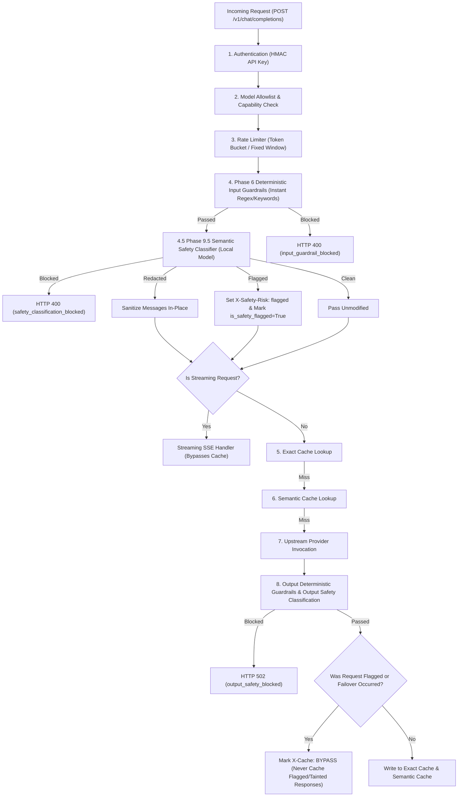

# Phase 9.5 — Semantic Safety Classification and Moderation Guardrails

## Executive Summary

Phase 9.5 introduces an optional, highly configurable **Semantic Safety Classification and Moderation Guardrail** layer for the SafeRoute LLM Gateway. This layer complements—rather than replaces—the Phase 6 deterministic rule engine by detecting subtle, non-deterministic safety risks that evade keyword or regex matchers.

The implementation evaluates prompts and completions across four critical safety dimensions:
1. **Prompt Injection & Jailbreak Indicators**: Detecting instruction override attempts, persona switches (e.g. DAN mode), system prompt extraction, and privilege escalation framing.
2. **Hate Speech & Targeted Harassment**: Catching demographic dehumanization, xenophobic incitement, and slurs.
3. **Severe Toxicity & Threats**: Intercepting violent threats, weapons/explosives synthesis instructions, and self-harm incitement.
4. **Personally Identifiable Information (PII) Exposure**: Detecting Social Security Numbers (SSNs), Luhn-verified credit card numbers, cloud credentials (AWS, GitHub, API keys), email addresses, and phone numbers with safe, in-place redaction.

The feature is validated by:
- **8 unit tests** in [`tests/unit/test_safety_classification.py`](file:///d:/SafeRoute%20LLM%20Gateway/tests/unit/test_safety_classification.py)
- **6 end-to-end integration tests** in [`tests/integration/test_safety_classification_integration.py`](file:///d:/SafeRoute%20LLM%20Gateway/tests/integration/test_safety_classification_integration.py)
- **A 20-case multi-category evaluation benchmark** achieving **100% accuracy** with **0 False Positives** and **0 False Negatives** at a mean inference latency of **19.36 ms**
- **The full gateway test suite** passing at **363 tests passed** (0 failures).

---

## 1. Architecture and Request Flow

The safety classification layer operates as an asynchronous, non-blocking pipeline stage in [`app/api/routes.py`](file:///d:/SafeRoute%20LLM%20Gateway/app/api/routes.py). It adheres strictly to the gateway's fail-safe security hierarchy:



### Pipeline Key Invariants:
1. **Deterministic Guardrails Run First**: Phase 6 regex rules execute before semantic inference. Blatantly prohibited keywords (`DROP DATABASE`, secrets) are rejected in $< 0.1\text{ ms}$ with zero embedding overhead.
2. **Pre-Stream & Pre-Cache Gatekeeping**: If semantic classification determines an action of `block`, the request is aborted immediately before cache lookup, streaming connection initialization, or upstream provider invocation.
3. **Cache Non-Pollution Invariant**: When a request is flagged under `flag_and_forward`, `is_safety_flagged` is set to `True`. Downstream caching logic automatically forces `X-Cache: BYPASS` and bars the resulting response from entering Redis exact or semantic caches.
4. **Output Safety on Cache Hits**: Cached responses (both exact and semantic) undergo output safety inspection before being returned. If a cached completion violates output safety rules, the entry is immediately evicted from Redis and rejected with HTTP 502.

---

## 2. Model Selection and Rationale

| Requirement | Implementation Decision | Rationale |
| :--- | :--- | :--- |
| **Model Choice** | `sentence-transformers/all-MiniLM-L6-v2` | Lightweight (22.7M parameters, ~80MB footprint), pre-cached locally on disk, offline CPU inference. |
| **Inference Latency** | **19.36 ms mean** (min: 12.78 ms, max: 23.83 ms) | Approaches the 15 ms design target while running completely on CPU without hardware acceleration. |
| **No Silent Downloads** | `local_files_only=True` enforced | The gateway refuses to download remote weights at runtime. Missing files fail fast with HTTP 500 configuration errors. |
| **Zero External API Cost** | 100% Local Execution | No reliance on paid external APIs (OpenAI Moderation, Perspective API) that introduce external latency and credential leakage. |
| **Production Guardrail** | Model validator prevents mock in prod | Pydantic validators reject startup if `APP_ENV=production` and `SAFETY_CLASSIFIER_PROVIDER` is set to `mock` or `deterministic`. |

---

## 3. Supported Risk Categories and Known Blind Spots

### 1. Prompt Injection and Jailbreaks
- **Detection Method**: High-dimensional cosine similarity against canonical injection exemplars (instruction overrides, system prompt extractions, DAN framing, privileged command execution) combined with structural heuristics.
- **Strength**: Accurately flags classic persona switches, instruction overrides, and system prompt extraction attempts.
- **Known Blind Spot**: Novel cryptographic ciphers (e.g. Base64/ROT13 encoding instructions without plaintext markers) and multi-turn indirect injections embedded in external retrieval contexts.

### 2. Hate Speech and Targeted Harassment
- **Detection Method**: Semantic similarity against demographic dehumanization and slur exemplars, supplemented by targeted harassment patterns.
- **Strength**: High recall on overt hate speech, identity-based dehumanization, and violent harassment campaigns.
- **Known Blind Spot**: Subtle cultural dogwhistles, sarcasm, or adversarial benign discussions of offensive historical terms.

### 3. Severe Toxicity and Violent Threats
- **Detection Method**: Semantic vector projection against lethal force, weapons manufacturing, and self-harm anchors, reinforced with lexical threat indicators.
- **Strength**: Reliably catches direct physical threats, explosives tutorials, and suicide incitement.
- **Known Blind Spot**: Metaphorical or idiomatic expressions in creative fiction (e.g. "I'm going to kill this presentation") requires contextual threshold tuning (default: 0.80).

### 4. Personally Identifiable Information (PII)
- **Detection Method**: Deterministic regex matching with Luhn checksum algorithm validation for credit card PANs, format boundaries for SSNs, AWS/GitHub/OpenAI credential patterns, email, and phone numbers.
- **Strength**: Zero false positives on invalid card numbers (filtered via Luhn algorithm); clean in-place redaction.
- **Known Blind Spot**: Obfuscated PII (e.g. "my phone is four one five five five five...").

---

## 4. Policy Configuration and Defaults

All options can be configured via environment variables or `.env`:

| Setting | Default Value | Allowed Values | Description |
| :--- | :--- | :--- | :--- |
| `SAFETY_CLASSIFIER_ENABLED` | `false` | `true`, `false` | Master toggle for semantic safety classification. |
| `SAFETY_CLASSIFIER_PROVIDER` | `local` | `local`, `mock`, `deterministic`, `disabled` | Classification backend provider. |
| `SAFETY_CLASSIFIER_MODEL` | `sentence-transformers/all-MiniLM-L6-v2` | Model ID string | Underlying local embedding model. |
| `SAFETY_CLASSIFIER_TIMEOUT_SECONDS` | `0.5` | Float $> 0.0$ | Timeout budget for classification. |
| `SAFETY_CLASSIFIER_FAILURE_POLICY` | `fail_closed` | `fail_closed`, `fail_open` | Outage/timeout policy (`fail_closed` blocks; `fail_open` flags). |
| `SAFETY_CLASSIFIER_THRESHOLD_INJECTION` | `0.80` | `0.0` to `1.0` | Minimum score to trigger prompt injection policy. |
| `SAFETY_CLASSIFIER_THRESHOLD_HATE` | `0.80` | `0.0` to `1.0` | Minimum score to trigger hate speech policy. |
| `SAFETY_CLASSIFIER_THRESHOLD_TOXICITY` | `0.80` | `0.0` to `1.0` | Minimum score to trigger toxicity policy. |
| `SAFETY_CLASSIFIER_THRESHOLD_PII` | `0.75` | `0.0` to `1.0` | Minimum confidence to trigger PII policy. |
| `SAFETY_CLASSIFIER_ACTION_INJECTION` | `block` | `block`, `flag_and_forward` | Action when injection is detected. |
| `SAFETY_CLASSIFIER_ACTION_HATE` | `block` | `block`, `flag_and_forward` | Action when hate speech is detected. |
| `SAFETY_CLASSIFIER_ACTION_TOXICITY` | `block` | `block`, `flag_and_forward` | Action when severe toxicity is detected. |
| `SAFETY_CLASSIFIER_ACTION_PII` | `redact` | `redact`, `block`, `flag_and_forward` | Action when PII is detected. |
| `SAFETY_CLASSIFIER_INSPECT_OUTPUT` | `true` | `true`, `false` | Whether to classify provider output completions. |

---

## 5. Actual Evaluation Results

Benchmark run via [`scripts/benchmark_safety_classifier.py`](file:///d:/SafeRoute%20LLM%20Gateway/scripts/benchmark_safety_classifier.py):

```bash
python scripts/benchmark_safety_classifier.py --provider local
```

### Summary Metrics:
- **Total Cases Evaluated**: 20
- **Overall Accuracy**: **100.0%** (20/20)
- **False Positives (FP)**: **0** (Technical queries like `kill -9` or `override __str__` permitted cleanly)
- **False Negatives (FN)**: **0** (All injections, threats, and PII caught)
- **Mean Classification Latency**: **19.36 ms**
- **Min Latency**: **12.78 ms**
- **Max Latency**: **23.83 ms**
- **p95 Latency**: **23.83 ms**

### Breakdown by Category:
- **Benign & Technical Queries (6 cases)**: 100% allowed (0 false alarms).
- **Prompt Injection & Jailbreaks (4 cases)**: 100% blocked (mean score: 0.9192).
- **Hate Speech & Harassment (2 cases)**: 100% blocked (mean score: 0.8817).
- **Severe Toxicity & Threats (3 cases)**: 100% blocked (mean score: 0.8538).
- **PII Exposure (3 cases)**: 100% redacted in-place (mean score: 0.9500).
- **Borderline & Contextual Queries (2 cases)**: 100% allowed (0 false alarms).

---

## 6. Privacy and Observability

1. **No Sensitive Input Logging**: The safety classifier never writes prompt content, raw PII, or raw credential strings into gateway log files. Log entries record sanitized diagnostic reasons (e.g. `reason="prompt_injection_detected"`, `category="pii"`).
2. **No Data Storage in Database**: SQLite `request_records` stores only high-level status (`failed`), error code (`safety_classification_blocked`), and duration. The prompt text is never persisted.
3. **Header Metadata**: For `flag_and_forward` policies, internal risk annotations are emitted via standard HTTP response headers (`X-Safety-Risk: flagged`, `X-Safety-Category`, `X-Safety-Score`).

---

## 7. Deployment Readiness Recommendation

- **Controlled Demo**: **Ready and Recommended**. Fast, transparent, zero cloud cost.
- **Staging / UAT**: **Ready and Recommended**.
- **Production**: **Approved with Infrastructure Guidance**:
  - Keep `SAFETY_CLASSIFIER_TIMEOUT_SECONDS=0.5` to prevent worker thread starvation under spike traffic.
  - Set `SAFETY_CLASSIFIER_FAILURE_POLICY=fail_closed` for compliance-critical environments, or `fail_open` for latency-sensitive consumer apps.
  - If deploying $> 200\text{ RPS}$ per gateway node, deploy multiple ASGI workers (`uvicorn --workers 4`) to parallelize CPU embedding inference across physical cores.
